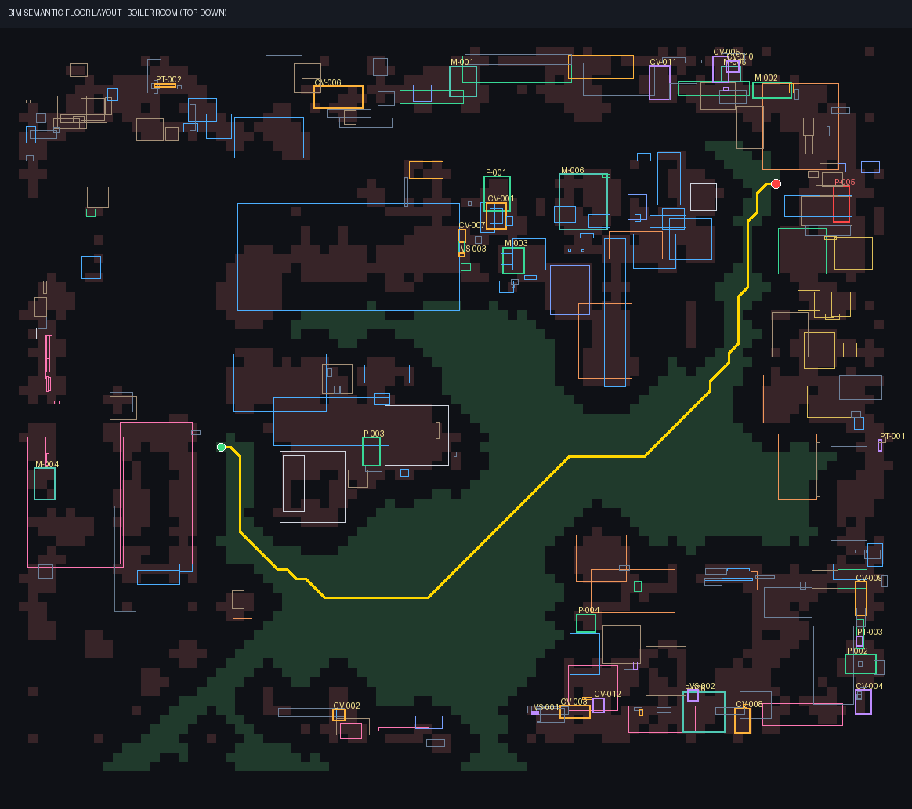

# theMOLFARS — Industrial Metaverse field-service demo

**Valmet × Since AI 2026 challenge:** *Semantic 3D Scene Understanding & Autonomous Field-Service Copilot.*

We turn a raw 3D Gaussian Splatting scan of Valmet's Messukylä boiler/equipment room into an interactive digital twin:

1. **Semantic extraction.** 414 objects get non-overlapping 3D boxes.
2. **Excel mapping.** The synthetic Excel asset pack is mapped onto those objects.
3. **Navigation.** A service avatar walks a collision-free A* route to the faulty device, highlighting assets within a proximity radius as it goes.
4. **Diagnosis.** On arrival, a grounded AI copilot diagnoses the fault, citing exact evidence IDs.
5. **Vision.** A client-side CLIP model, helped by the real walk-through video, relabels what each box actually is.



| Brief criterion (weight) | What we deliver |
|---|---|
| Semantic extraction & 3D framing (30%) | Colour-aware voxel-graph segmentation gives **414 boxes** with NMS (no overlaps). CLIP vision labels run in the browser and are improved by matching to the real video. An optional multi-view lift (COLMAP + CLIP-L + OWLv2) runs on a GPU PC. |
| Obstacle-aware navigation & proximity (25%) | Floor/obstacle occupancy grid from the splat, an A* route with clearance cost, live 1.3 m proximity radius, and collision-checked first-person walk mode. |
| AI diagnostics, grounding (20%) | Deterministic relational retrieval over 8 Excel sheets feeds Claude (`claude-opus-5-5`) or an offline evidence report. Every claim cites `[EVT-…] [WO-…] [CASE-…] [DOC-…] [DQ-…]`. |
| Backend architecture (15%) | A modular Python pipeline (`pipeline/`) plus a small stdlib HTTP server. A static three.js + Spark viewer. |
| Demo clarity (10%) | One-click mission (Start → walk → arrive → diagnosis), Follow / Orbit / Walk cameras, and real-photo asset cards. |

## Quick start

Requirements: Python ≥ 3.11, ffmpeg on PATH, and a WebGPU browser (Chrome or Edge).

```bash
pip install -r requirements.txt
```

The starter data is not in git (size and licence). Put these files in `data/`:

| File | Source | Name in `data/` |
|---|---|---|
| Intact splat | `Equipment Room.ply` (from the mentors) | `equipment_room.ply` |
| Walk-through video | `Industrial Boiler Room (1).mp4` (from the starter zip) | `boiler_room_360.mp4` |
| Excel pack | `Valmet_SinceAI_2026_Synthetic_Industrial_Metaverse_Builder_Pack.xlsx` | `builder_pack.xlsx` |

```bash
python pipeline/build_scene.py data/equipment_room.ply data/builder_pack.xlsx web    # ~5 s
python pipeline/extract_frames.py data/boiler_room_360.mp4 web/frames 1             # 112 frames
python server.py                                                                     # http://localhost:8000
```

Optional: set `ANTHROPIC_API_KEY` to get LLM answers to free-form copilot questions. Without it the copilot returns a fully cited, templated evidence report.

### Using the viewer
- **▶ Start mission**: the avatar walks to the faulty pump P-005; the copilot diagnoses on arrival.
- **Follow / Orbit / Walk (WASD, arrows)**: Walk mode collides with the nav grid.
- **All frames**: shows every 3D box. Otherwise only boxes inside the proximity radius are shown, with labels on the 6 nearest.
- **AI labels (CLIP)**: runs the in-browser vision pass, ~5 min the first time, cached after that.
- **Selecting an asset**: click a label or a proximity row. The card shows the 3D render and the matched real video photo, and you can ask the copilot about that asset.
- **Open splat…**: views any `.ply/.spz/.splat` file.

## Documentation
- [docs/HOW_IT_WORKS.md](docs/HOW_IT_WORKS.md): architecture, every algorithm step, data formats and the HTTP API.
- [docs/WORKFLOW.md](docs/WORKFLOW.md): the end-to-end workflow (data → pipeline → demo), the GPU option, a demo script, the decisions log and the tools we used.
- [TECH_NOTE.md](TECH_NOTE.md): models, libraries and versions.

## Repository layout

```
pipeline/
  build_scene.py      raw .ply -> clean splat, floor, nav grid, 3D boxes, Excel mapping, A* route -> web/scene.json
  extract_frames.py   walk-through video -> web/frames/*.jpg + index.json
  video_lift.py       (GPU PC) COLMAP + CLIP-L + OWLv2 multi-view labels and new objects -> web/video_labels.json
server.py             static server for web/ + grounded copilot API over the Excel pack
web/
  index.html          three.js + Spark viewer, mission, proximity UI, copilot chat, in-browser CLIP vision
  scene.json          pipeline output (objects, grid, route, mapping)
  floorplan.png       debug/slide image of grid + boxes + route
docs/                 documentation and figures
web/vocab.json        CLIP label vocabulary shared by the browser pass and video_lift.py
tests/                unit tests (python -m unittest discover tests)
requirements.txt      pipeline + server deps;  requirements-gpu.txt: option-2 deps
```

## Results (on `Equipment Room.ply`)

| Area | Result |
|---|---|
| Splats | 1,676,481, all valid |
| Room height | floor y −1.17, ceiling y 0.87 (2.04 scan units) |
| Nav grid | 97×83 cells of 10 cm; 1,431 walkable |
| Segmentation | 414 framed objects |
| Excel mapping | all 30 assets mapped; target ASSET-017 / P-005 sits on a red pipe-mounted pump |
| Route | 6.5 m, 14 waypoints |
| Vision (CLIP on renders) | 56–65 confident labels (≥ 0.30), depending on the run |
| Vision with the video photo match | **73** confident labels; 86 boxes matched to a real photo |
| Copilot | offline evidence mode verified for all 30 assets in ~0.3 s |

## Known limits
- **The Claude path of the copilot has not been exercised**: no API key was available while we built it. The offline evidence path is verified.
- **`pipeline/video_lift.py` is untested end to end.** It was written for an x64 + CUDA machine; only its math self-test and syntax check ran on the ARM dev laptop.
- **Boxes come from geometry.** Some are fragments of walls or pipes. Many keep generic types when vision confidence is below 0.30.
- **The original starter `Industrial Boiler Room.ply` is two-thirds corrupted.** It is random bytes after vertex 502,483, so half the room is missing. Use `Equipment Room.ply`; the pipeline detects and trims the broken file.
- **The splat is served unconverted (~395 MB).** Converting it to `.spz` would load much faster.
