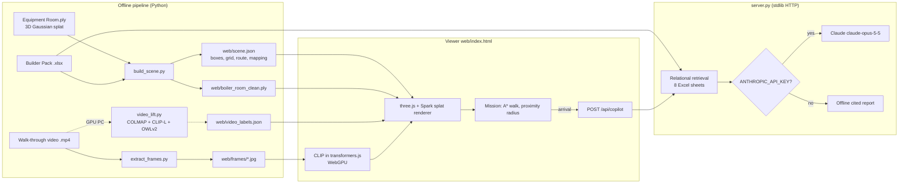

# How it works

## System overview



The heavy, deterministic work runs offline in about 5 s. It turns the raw splat into a semantic layer (`scene.json`). The browser renders the splat with the semantic layer on top and runs the mission. It can also run a vision model locally. The server stays thin: static files plus one copilot endpoint.

---

## 1. Offline pipeline — `pipeline/build_scene.py`

Input: a binary little-endian 3DGS `.ply` (float32 properties `x y z scale_* rot_* f_dc_* opacity f_rest_*`) and the Excel pack.
Output: `web/scene.json`, `web/boiler_room_clean.ply`, `web/floorplan.png`.

### 1.1 Load and sanitize
- The header is parsed and the body is read as an `N × P` float32 matrix (`np.frombuffer`, zero-copy).
- **Sanity mask:** a row is valid if all its values are finite, |xyz| < 50, and log-scales are in (−20, 3).
- **Corrupted-tail detection.** The whole rest of the file is cut from the first invalid row only if fewer than 50% of the rows after it are valid **and** the file's last 1,000 rows are mostly invalid. A bad block in the middle of an otherwise good file loses only its own rows. `tests/test_build_scene.py` covers a clean file, a garbage tail and a mid-file bad block. The original starter file (`Industrial Boiler Room.ply`) is valid only up to vertex 502,483. After that it holds noise (entropy 7.92 bits/byte, no float structure). Splats are stored in octree order, so the missing part is a whole region of the room.
- The cleaned splat is written back with the same header and an updated vertex count.

### 1.2 World frame, floor, ceiling
- The capture is y-down (COLMAP convention). World = rotate 180° about X: `(x, −y, −z)`. The viewer does the same with `mesh.rotation.x = π`.
- The floor and ceiling are the dominant peaks in the lower and upper thirds of a 2 cm histogram of opaque splat heights (opacity > 0.3).

### 1.3 Navigation grid (10 cm cells)
- **Observed floor** = cells with splats within ±12 cm of the floor height. A binary closing (4 iterations) and hole filling close gaps.
- **Obstacles** = cells with opaque splats between floor + 0.2 m and floor + 1.7 m (head height). A cell counts if it has ≥ 4 hits after a morphological opening, or ≥ 12 hits on its own.
- **Inflation:** obstacles are dilated by the avatar radius (0.22 m).
- **Walkable** = observed floor ∧ ¬inflated obstacle, keeping only the largest connected component.
- A clearance map (Euclidean distance transform) is kept for path costs.

### 1.4 Semantic extraction: 3D boxes
1. **Input splats:** opacity > 0.3, max scale < 0.25 m, between floor + 6 cm and ceiling − 20 cm.
2. **Voxelize** at 4 cm. Each voxel stores its splat count and mean colour (from the SH DC term: `0.5 + 0.282·f_dc`).
3. **Colour-aware connectivity:** a sparse graph links 26-neighbour voxels **only if their mean colours differ by < 0.10 per channel**. `scipy.sparse.csgraph.connected_components` gives the objects. This separates a red pump from the white insulated pipe it sits on and from the grey wall. Plain connectivity fused them into a few huge blobs: 46 boxes on the old file, versus 128 with colour, and 414 on the intact file.
4. **Box per component:** the 2nd–98th percentile extent, which drops stray splats. Specks (< 8 cm) and slabs (> 2.5 m: walls, ceiling) are discarded, as are components with fewer than 30 splats.
5. **NMS:** a box is dropped if more than 35% of the smaller box lies inside an already-kept, bigger box. As a result, frames never stack on top of each other, as the brief requires.
6. **Optional union with the ml branch (`--boxes inputs/ml_segment`):**
   - Boxes from the team's Open3D `segment.py` are converted into this frame through its `transform.json` (yaw boxes become axis-aligned) and NMS'd.
   - Those that overlap none of ours by more than 35% are added.
   - Measured: +77 boxes, of which 6 read as equipment, so it is off by default.
7. **Heuristic class** from geometry and colour:
   - saturated red, mounted > 0.4 m above the floor, 0.2–0.8 m in size → *circulation pump*;
   - saturated red on the floor → *storage bin* (never mapped to an asset);
   - tall and thin → *vertical pipe*; long and flat → *horizontal pipe*;
   - small and high → *valve positioner / instrument*; small and low → *local measurement*;
   - low and compact → *motor/drive*; large → *tank/cabinet*.

### 1.5 Excel mapping
- `Asset_Master` is joined with `Current_State`. The **worst health score becomes the mission target** (ASSET-017, P-005, process pump, fouling, health 44).
- The mapping is procedural and class-compatible, which the brief explicitly allows. With a fixed seed, each object takes a free asset of the same class first, then of a compatible class (pump ↔ motor; valve ↔ transmitter ↔ vibration sensor). Leftover assets go to the remaining non-pipe, non-storage objects.
- **Target placement:** the target asset is moved onto a reachable object of exactly its class (≤ 1.3 m from an aisle, because pumps are wall-mounted). If none exists, a compatible class is used (≤ 1.0 m), then any equipment box (≤ 2.0 m). If even that is empty, the pipeline stops with a clear message. Among the candidates it picks one far from the start, but not the very edge of the scan. If no box received the target asset during mapping, the box gets the full Master + Current_State record, so health and status are always present.

### 1.6 Route
- The start is the walkable cell nearest the left edge of the scan. The goal is the walkable cell nearest the target box.
- **8-connected A\*** with no corner cutting. Step cost `c · (1 + 1.5 / (0.2 + clearance))`, so the path stays in the middle of aisles.
- **String-pulling:** the route is shortened by line of sight, but only through cells with ≥ 15 cm clearance.
- Self-checks: the route must exist and every cell on it must be walkable (`assert`).

### 1.7 `scene.json` format
```jsonc
{
  "splat": "boiler_room_clean.ply", "frame": "rotate_x_180",
  "floor_y": -1.17, "ceiling_y": 0.87,
  "grid": { "origin": [x0, z0], "cell": 0.1, "w": 97, "h": 83, "walkable": "0101…" }, // row-major by z
  "objects": [{ "id": "OBJ-182", "cls": "PROCESS_PUMP", "label": "Circulation pump (red, pipe-mounted)",
                "center": [x, y, z], "size": [sx, sy, sz], "color": [r, g, b],
                "asset": { "asset_id": "ASSET-017", "tag": "P-005", "condition_state": "…", "health_score": 44, … } | null }],
  "target_object": "OBJ-182", "target_asset": "ASSET-017",
  "path": [[x, y, z], …],
  "scene_id": "9dd32119e0b1"   // SHA-1 of the box geometry; object IDs are valid only for these boxes
}
```

---

## 2. Viewer — `web/index.html`

This is a single static page with no build step. It loads three.js 0.180 and Spark 2.4 (a Gaussian-splat renderer for three.js) from a CDN through an import map.

- **Splat:** `SplatMesh({ url })`, rotated 180° about X to match the pipeline frame. *Open splat…* loads any local file through `fileBytes`.
- **Boxes:** `EdgesGeometry` line boxes coloured by status: green healthy, amber warning, pulsing red target, grey unmapped, cyan discovered from video. Labels are `CSS2DObject`s.
- **Mission:** the avatar (a capsule plus a proximity ring) moves along `path` at 0.45 m/s. On arrival it calls the copilot.
- **Proximity display:** each frame, only boxes within **1.3 m** are visible (or all of them with *All frames*). Only the **6 nearest** get text labels, with Excel assets first, so labels never pile up. The side panel lists the nearby assets with their status chips.
- **Cameras:** *Follow* (third person), *Orbit* (overview under the ceiling), *Walk* (first person). Walk mode moves with WASD/arrows and tests the next position against the walkable grid on each axis separately, so the user slides along walls instead of passing through them.

### 2.1 In-browser vision (CLIP, transformers.js)
Pressing **AI labels (CLIP)**:
1. **Loads `Xenova/clip-vit-base-patch16`** (set in `web/vocab.json`) through `@huggingface/transformers` 4.3.2 on **WebGPU**, with a WASM fallback.
   - It loads the vision and the text tower: `CLIPVisionModelWithProjection` and `CLIPTextModelWithProjection`, fp16 when the GPU has `shader-f16`, q8 otherwise.
   - The browser caches the weights after the first download.
2. **Renders each box:**
   - The camera is placed on the side of the nearest aisle cell (the view a technician gets), ≥ 0.8 m away because splats blur up close.
   - The main loop is paused. The view is rendered for 3 frames so Spark can re-sort the splats for the new viewpoint.
   - The projected box is cropped as a square with 80% context and scaled to 224².
3. **Classifies against `web/vocab.json`,** which `video_lift.py` also reads. It has 14 classes:
   - equipment: pump, motor, valve, gauge, cabinet, tank;
   - infrastructure: pipe;
   - clutter: washing machine, chair, ladder, box, cart, lamp, wall/floor.

   Each class has 2–5 prompts. Its text embedding is the mean over all prompts × 4 templates (a *prompt ensemble*).
4. **Prototypes.** Each class also gets a visual prototype: the mean embedding of its 129 hand-labelled tiles from our walk-through video (`web/prototype_tiles.json`). The tiles are already embedded during video indexing.

   The score is `100 · (cos(text_c, v) + w · (cos(proto_c, v) − mean))` with `w = proto_weight` (0.25). A softmax over the classes gives the confidence.
5. **Decision:** confidence ≥ `min_score` (0.4) shows the class name. Below it the frame reads **"Unidentified object"** instead of a shape guess (the guess stays in the tooltip). Clutter frames that carry no Excel asset are faded.
6. **Saving.** The results go to `POST /api/vision` → `web/vision_labels.json`, keyed by `scene_id`. Every viewer loads them on start, so the labels are there without pressing the button again.

#### Benchmark (`tests/vision_eval.json`)
The test set is 50 render crops, hand-labelled by eye with 13 coarse classes; 22 ambiguous crops of the 72 sampled were left out. It measures accuracy at the object in the crop centre. With 50 samples, differences of ±7 points are noise.

| Variant | CLIP B/32 | **CLIP B/16** | CLIP L/14 |
|---|---|---|---|
| Old vocabulary (16 prompts, 1 template) | 30% | 58% | 52% |
| New vocabulary, 1 template | 52% | 64% | 62% |
| New vocabulary + 4-template ensemble | 58% | **66%** | 66% |
| Video prototypes only (kNN) | 50% | 46% | 50% |
| Ensemble + video prototypes (best weight) | 64% | 66% | 68% |

B/16 has about the same download size as B/32 and needs no prototypes to reach 66%. L/14 is ~4× larger and only marginally better. On B/16 at the 0.4 threshold, labels are shown for 38/50 crops with 74% precision.

What this measured:
- The main remaining errors are crops of large boxes whose framing shows a whole corner of the room, and confusions between pipe, valve and pump.
- The video prototypes add nothing measurable on B/16.

### 2.2 Photo match with the walk-through video
CLIP struggles on blurry splat renders, while the video shows the same equipment sharply.
1. `extract_frames.py` produces 112 frames at 1 fps.
2. Each frame is cut into **13 overlapping square tiles** (3 full-height, 10 half-height), and each tile is embedded with CLIP. The embeddings are computed once, then stored in the browser **Cache API**, keyed by a hash of the source video that `extract_frames.py` writes into `frames/index.json`.
3. Each box render is embedded and matched to tiles by **CSLS** (cross-domain similarity local scaling):
   `csls(o, t) = 2·cos(o, t) − r_o − r_t`, where `r` is the mean of the 10 best cosine similarities. With plain cosine, one blank-wall frame was the nearest neighbour of 105 of 414 renders (hubness). CSLS cut that to 37, and the remaining top pairs are visually correct.
4. Matches with CSLS ≥ 0.03 (calibrated by eye on match pairs) have their sharp tile classified. The photo label wins when it is more confident than the render label.
5. The asset card shows the render next to the matched real photo, cropped directly from the frame JPEG with CSS (no canvas needed).

The photo match reuses the tile embeddings, so no frame is decoded twice. Results are saved on the server (see 2.1). `scene_id` is a fingerprint of the box geometry, so it changes only when the boxes change. Labels from an older run are never applied to renumbered boxes.

---

## 3. Multi-view lift (GPU PC) — `pipeline/video_lift.py`

This is the "2D foundation models lifted to 3D" path recommended by the brief. It needs an x64 machine with CUDA.

1. **SfM:** ffmpeg samples frames at 2 fps. Then pycolmap runs SIFT features → sequential matching → incremental mapping, which gives camera poses and a sparse point cloud.
2. **Alignment COLMAP → splat world:**
   - initial scale from the 5th–95th percentile extents;
   - FPFH features, then RANSAC with a scaled point-to-point estimate (Open3D);
   - ICP with scaling.
   The script writes `work/align_check.ply` (splat in grey, aligned COLMAP points in red) to check by eye. If the fitness is too low, the user passes ≥ 4 hand-picked point pairs and the Umeyama closed-form similarity is used instead.
3. **Multi-view labels:**
   - **Occlusion check:** a frame may vote for a box only if it observes at least 3 of the COLMAP points that lie inside the box. Boxes with fewer than 3 SfM points keep their browser label.
   - Each box's 8 corners are projected into every remaining frame. Views behind the camera, off-image or smaller than 40 px are rejected.
   - The 6 largest and closest views are kept and padded crops are classified with **CLIP ViT-L/14**.
   - The class probabilities are averaged over the views.
4. **New objects:**
   - **OWLv2** (`owlv2-base-patch16-ensemble`) detects the equipment vocabulary on about 120 frames.
   - Each detection is lifted to 3D from the COLMAP points observed inside its 2D box: median-centred, outliers trimmed, 10th–90th percentile box.
   - Detections that don't overlap an existing box by more than 30% are added.
5. **Output:** `web/video_labels.json` (`scene_id`, `labels` per object id, `extra_objects`, `world_from_colmap`). The viewer picks it up automatically, but ignores it (with a console warning) if its `scene_id` differs from the current `scene.json`. Multi-view labels take priority, and the new objects are drawn in cyan.

`python pipeline/video_lift.py --selftest` checks the Umeyama fit and the projection math without a GPU.

---

## 4. Copilot — `server.py`

### HTTP API
| Method | Path | Body / response |
|---|---|---|
| GET | `/` and static files | served from `web/` |
| GET | `/api/assets/{asset_id}` | the full evidence context for one asset (JSON) |
| POST | `/api/copilot` | `{asset_id, question?, history?}` → `{mode, answer}` |

### Retrieval (deterministic and relational)
There are only 30 assets, so we use no vector store. For the asset ID the server collects:
- `Asset_Master`: identity and criticality;
- `Current_State`: health, issue code, confidence and urgency;
- `Telemetry_Sample_3d`: the trend of every numeric signal (first, last, min, max, mean);
- `Alarms_Events`: the latest high/critical/medium events;
- `Maintenance_History`: work orders;
- `Historical_Service_Cases`: cases with the same class and issue code;
- `Knowledge_Docs` and `Data_Quality` flags.

The result is about 11 k characters of JSON, and every row keeps its evidence ID.

### Generation
- **With credentials:** Claude `claude-opus-5-5` through the official `anthropic` SDK, with low effort and a server-side refusal fallback. The system prompt requires 4 sections: *what is wrong*, *why*, *safe next steps (lockout first)* and *data trust*. Every claim must cite IDs (`Builder_Questions` Q-03), and the model may answer only from the context.
- **Without credentials, or on any API error:** a templated report from the same context.
  - It lists telemetry signals that moved by more than 8%, and the last alarms and work orders.
  - Steps come from the matching historical cases and the knowledge doc, preceded by permit and lockout.
  - It ends with all data-quality flags.

### Hardening
- Request bodies are parsed defensively; `asset_id` is required. Questions are cut to 2,000 characters, and only the last 10 user/assistant messages are passed through.
- An unknown asset returns 404 or 400 instead of an exception.
