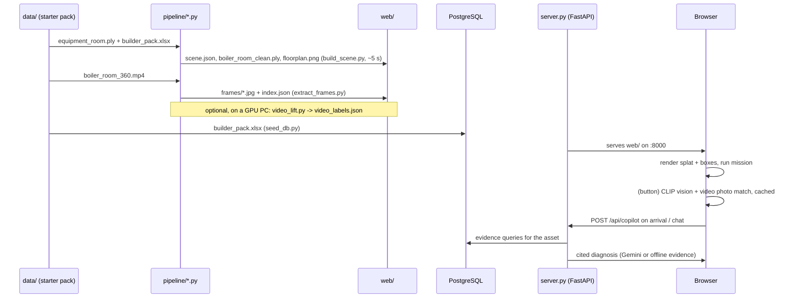

# Workflow, decisions and tools

## 1. End-to-end workflow

### Step by step
1. **Prepare the data.** Copy `builder_pack.xlsx` and `boiler_room_360.mp4` into `data/` (names in the README); the splat downloads itself from the team's Google Drive. Nothing in `data/` is committed. With Docker, `docker compose up --build` does steps 2, 4 and the server in one go.
2. **Build the scene:** `python pipeline/build_scene.py data/equipment_room.ply data/builder_pack.xlsx web`. Optional `--boxes inputs/ml_segment` adds the ml branch's boxes that don't overlap ours (see the decisions log: +6 equipment, +58 clutter boxes, so off by default).
   - Read the log: sanitize counts, floor and ceiling heights, grid size, number of walkable cells, objects, route length.
   - Check `web/floorplan.png`. Green is walkable, red is obstacle, blue are boxes, the red box is the target and yellow is the route.
3. **Extract the video frames:** `python pipeline/extract_frames.py data/boiler_room_360.mp4 web/frames 1`.
4. **Start the database and serve:**
   - `docker compose up -d` (PostgreSQL), then `python seed_db.py` (loads the Excel pack; re-run after changing it). Without Docker skip this: the server falls back to SQLite seeded from the same Excel.
   - `python server.py`, then open http://localhost:8000. Wait for the splat to load (~395 MB, a few seconds).
5. **Run the vision pass once.** Press **AI labels (CLIP)**.
   - The first run downloads CLIP B/16, indexes the video tiles (~4 min) and labels 414 boxes (~3 min). Later runs reuse the cache.
   - The result is saved to `web/vision_labels.json`, so every viewer shows the labels without running it again.
   - Optional: re-run the same build command with `--vision web/vision_labels.json` added. Excel assets then go onto boxes that vision recognised as pumps, valves, gauges and motors, never onto chairs, washing machines or walls. The boxes stay the same, so the labels stay valid.
6. **Run the demo:** press **▶ Start mission** (see §3).
7. **Optional, on a GPU PC:**
   - set up a venv with CUDA torch and `requirements-gpu.txt`;
   - run `python pipeline/video_lift.py --selftest`;
   - run `python pipeline/video_lift.py data/boiler_room_360.mp4 web/scene.json data/equipment_room.ply work --fps 2`;
   - copy `web/video_labels.json` to the demo machine and reload the viewer.
8. **Optional:** put `GEMINI_API_KEY=…` in `.env` (git-ignored) and restart `server.py` to turn on LLM answers to free-form questions and the Gemini vision buttons.
9. **Optional, with the key:** `python pipeline/gemini_vision.py` labels every box with Gemini (`--only-missing` for new boxes only), then re-run step 2 so the Excel mapping follows the new labels.

### Re-running after changes
- Changing the splat, the Excel file or a pipeline parameter needs only step 2 again. Then do a hard reload in the browser.
- Caches never outlive their input. Vision labels and `video_labels.json` are tied to `scene_id` (a hash of the box geometry, so a re-map with `--vision` keeps them valid), and the video tile embeddings to a hash of the source video. After a rebuild, re-run **AI labels** and, if you use it, `video_lift.py`.
- Tunable constants:
  - pipeline: top of `build_scene.py` (`VOXEL`, `COLOR_TOL`, `MIN_PTS`, `CELL`, `ROBOT_R`, `HEAD`);
  - vision: `model`, `min_score`, `proto_weight`, classes and prompts in `web/vocab.json`; refinement rules in `refine_vision` (`build_scene.py`);
  - viewer: `RADIUS`, `MAX_LABELS`, `SIM_MIN` in `index.html`.

## 2. Verification we ran
- Round 3 (items 1–10): 21 unit tests now. New: Q-04 priority ordering and the saved tour (urgent first, path indices increasing), the Q-02 detector (a late step is flagged, a noisy stable signal is not), the citation check (an invented `EVT-99999` is flagged; the offline report and narration verify fully), oriented frames (45° plank gets a yaw, an axis-aligned one does not), groups (touching parts join, assets never), the Drive download (a `.ply` is kept, an HTML page is refused), USD export, and live telemetry ingest (stored, read back, a non-column key refused). A CI dry run without `data/` passes with the 6 database tests skipped.
- In the browser: narration lines and citation marks, the tour intro, sparklines, isolation (only P-005's 751 splats shown; Esc returns) and the first three 🎬 Demo steps were checked; the walking animation itself was not (hidden pane).
- Unit tests: `python -m unittest discover tests`:
  - sanitize: clean file, garbage tail, mid-file bad block;
  - saved outputs (`SavedVisionLabels`): labels match the scene, ≥ 75% on the benchmark, every object has vision fields, all 30 assets sit on equipment. No Gemini wording is asserted, so re-running `gemini_vision.py` keeps them green;
  - `PostgresBackend`: the evidence context for ASSET-017, the object context, the confidence rule (Q-06), and that a `text/plain` POST gets 415 (the CSRF guard); needs the server deps and either the seeded database or `data/builder_pack.xlsx` for the SQLite fallback.
- API_Contract routes checked against the SQLite fallback: telemetry (144 rows for ASSET-017), events (34), documents (own card + class + site docs), scene anchors (30, all mapped to scan boxes), work-order draft (high priority, 7 steps, evidence IDs), unknown asset → 404/400.
- Server smoke test with a fake Gemini client (on 0d19530 + fixes): 3 parallel Gemini requests finish in 0.7 s instead of queueing, and all 3 labels are saved; oversized and non-base64 bodies get 400; a non-numeric `score` is clamped.
- A rebuild from the committed `vision_labels.json` reproduces every box's class and the target; assets of one class may swap tags.
- Nav grid with point-exact clearance: 2,276 walkable cells (was 1,431); route 8.9 m / 11 waypoints, every cell asserted walkable and ≥ 0.224 m from every obstacle splat; `NavGrid` tests: a 0.6 m gap is passable, a 0.3 m gap is not.
- `AssetMapping` test: the worst-health asset goes to the box that fits and never to a box vision calls a wall (it fails if walls are allowed).
- Security checks on a copy of `web/`: `text/plain` POSTs to all 4 endpoints get 415 and the labels stay intact; a planted `` label shows as text in the viewer and does not run.
- Vision benchmark: 50 hand-labelled render crops (`tests/vision_eval.json`) × 3 models × 6 variants. See HOW_IT_WORKS §2.1.
- The pipeline asserts that the route exists and stays on walkable cells, and that a target box can be found.
- `video_lift.py --selftest` checks the Umeyama similarity fit and the projection math.
- Copilot retrieval ran for all 30 assets plus an unknown ID (KeyError → 404) on the earlier stdlib/pandas server; the PostgreSQL retrieval keeps the same queries and output shape.
- In the browser we checked the full mission (walk, arrive, diagnosis), the collision in Walk mode, the label cap, the vision pass, the CSLS match pairs (inspected visually) and that the cached results come back after a reload.
- **Not verified:**
  - the real Gemini API (copilot and vision) on this machine: `google-genai` needs `cryptography`, which has no Windows-on-ARM wheel for Python 3.14;
  - `video_lift.py` end to end (it needs an x64 + CUDA machine);
  - non-Chromium browsers.

## 3. Demo script (≤ 5 min video)
**🎬 Demo** in the viewer plays steps 1–4, the isolation of P-005 and the start of the inspection tour by itself, with captions (~2 min). Record it, then add 5–6 by hand. Keep the browser tab visible: hidden tabs pause the animation.

1. **Overview (Orbit, All frames):** the full room with 414 boxes. Mention the colour-aware segmentation and NMS.
2. **Floor plan slide:** the grid, the obstacles and the A* route.
3. **▶ Start mission (Follow):** frames light up only within the radius, and the side panel lists nearby assets with their Excel status.
4. **Arrival at P-005:** the copilot report, with its 4 sections and evidence IDs. Ask a follow-up question.
5. **Click a nearby asset:** the 3D render next to the real video photo, plus the vision label.
6. **Walk mode:** walking into a wall stops you. That is the collision check against the nav grid.
7. **🧭 Inspection tour / 🔎 Isolate / sparklines:** the Q-04 order with reasons, one object on its own, the detector's flagged signals in a card.

## 4. Decisions log (what we found and changed)

| Problem | Evidence | Decision |
|---|---|---|
| The starter `.ply` was mostly garbage | 1.5 M vertices, but only the first 502,483 are valid. The tail has entropy 7.92 bits/byte, is not a compressed stream and is not copied from the videos. The zip CRC is OK, so it was broken at the source. | Detect and cut corrupted tails in the pipeline, then ask the mentors for an intact scan (`Equipment Room.ply`, 1,676,481 valid splats). |
| Naive `np.fromfile` after reading the header with `readline` gave NaNs | Buffered reads moved the file position | Read the whole file and use `np.frombuffer` from the end-of-header offset. |
| Few objects (19 → 46) | Plain voxel connectivity fused wall + pipe + pump | A colour-aware voxel graph gives 128 objects on the broken scan and 414 on the intact one. |
| The faulty pump landed on red plastic bins | The rule "red + low = pump" matched floor bins | Saturated red + wall-mounted + 0.2–0.8 m = pump; red on the floor = storage bin (not an asset); exact class is preferred for the target. |
| Labels overlapping on dense walls | 128+ boxes in view | Show labels only inside the radius and only on the 6 nearest, Excel assets first. |
| CLIP on splat renders was weak | Crops from 0.35 m were blur | Keep the camera ≥ 0.8 m away and add 80% context: confident labels went 41 → 65. |
| Loading CLIP stalled | fp32 weights are ~600 MB | q8 for the classifier and fp16 for the embeddings on WebGPU, which is ~4× faster than q8 there. |
| Photo matching dominated by one frame | A blank-wall frame was the top-1 match for 105/414 boxes | CSLS hubness correction plus a threshold calibrated on pairs: confident labels 56 → 73. |
| Vision labels wrong on obvious things (green chair → "motor", washing machine → "valve") | Only 30% correct on 50 hand-labelled crops; the old vocabulary had no class for those objects, and below the threshold the shape guess was shown | 14-class vocabulary incl. clutter, 4-template prompt ensemble, CLIP B/16 (66%), "Unidentified object" below 0.4 (74% precision), labels saved server-side and fed back into Excel mapping. |
| Combine with the team's ml branch (Open3D: RANSAC walls, DBSCAN, yaw boxes, size-based Excel mapping) | Same CLIP pass on both box sets. ml raw: 435 boxes, 110 read as equipment, but 67 overlapping pairs; after NMS 370 boxes / 90 equipment (main: 414 / 99). The sets complement each other (33 equipment only in ml), but adding ml's non-overlapping boxes to ours gave +6 equipment and +58 wall/clutter boxes. A NumPy port of the RANSAC wall removal found no real walls in our splat points (best planes held ~2% of points, random slices). ml's size-based mapping put 15/30 assets on clutter. | Kept main's segmentation and vision-based mapping; `--boxes` stays opt-in (`inputs/ml_segment/`) to re-run the comparison as the ml branch evolves. |
| In-browser LLM copilot without a key (SmolLM2-1.7B-Instruct, transformers.js on WebGPU) | q4f16 produced garbage on this Windows-on-ARM GPU even for one-line prompts; q4 worked but took 35–96 s per answer with a ~900-token evidence context; in 3 test questions it cited 0 evidence IDs, invented hydraulic details, and gave a wrong seal-inspection date (evidence: [WO-00260], 2026-05-15). The 360M model only copied report lines | Not shipped: free-form questions need the server-side LLM (`server.py`); the arrival report stays the deterministic, fully cited template. |
| Vision still wrong on many boxes after CLIP (26/50 render-only on the benchmark) | Gemini sees the same crops and names everyday items correctly | `gemini_vision.py` (batch) and two live Gemini buttons; `refine_vision` geometry rules; 49/50 on the benchmark. The committed scores still carry a 0.55 floor (removed from the script; re-run to fix), and part of the rules are room-specific: see HOW_IT_WORKS §2.3. |
| Gemini endpoints froze the server and could lose labels | The blocking SDK call ran on the event loop; files were read before the call and written after | Call in a worker thread and re-read the files right before the write; 5 MB body limit; scores clamped. |
| Audit (ponytail): any website could overwrite labels on the local server and inject HTML through them | A cross-site `text/plain` POST got 200 and left 1 of 414 labels; an `` label was rendered as HTML | JSON-only POSTs (415 otherwise), labels escaped in the viewer, Postgres bound to localhost, splat revalidated instead of re-downloaded, Gemini score floor removed, room-specific rules gated by `scene_id`, one shared room note and class rule, copilot body and history capped, an asset-mapping test. |
| A third of the floor looked unused | Cell classes: 28% obstacle, 43% avatar-radius margin, 8% free but cut off, 22% walkable. The margin was measured to whole 10 cm cells, so every gap looked 10–15 cm narrower than it is; the corridor along the equipment wall (a 0.9 m gap between a pipe bend and a shelf, seen in a cross-section of the splat) was cut off | Clearance measured to the real obstacle splats with a k-d tree, same 0.22 m person radius: 2,276 walkable cells (+59%). The route now runs along the equipment wall and passes 14 assets instead of 5. The target stays on a pump-shaped box far from the start. |
| The copilot spoke only at the end of the walk; the brief asks it to explain status along the path | 14 assets pass the radius on the route and only P-005 was explained | One cited, deterministic line per asset as it enters the radius (`/brief`), no LLM call per asset. |
| Grounding was claimed, not checked | Nothing stopped a model from citing an ID that is not in the data | Every answer's IDs are checked against the retrieved context; unknown ones are struck through. |
| One target does not show work planning (Q-04) | 13 assets are not healthy | Priority = damage × criticality × (1 + uncertainty); a tour over all of them, urgent first, shortest walk inside each level (57 m). |
| We only repeated the pack's own diagnosis (Q-02) | `model_confidence` comes from the pack | A robust level + trend detector on the raw telemetry: AUC 0.91 against the pack's labels without seeing them; weak on P-005, said openly. |
| 414 frames looked like noise on walls and pipe runs | 129 boxes were touching parts of the same thing | Group them (49 objects) and orient 88 frames by PCA, display-only so labels stay valid. |
| Every developer had to copy a 395 MB `.ply` by hand | — | Download from the team's Google Drive on first run, verified and resumable by re-run. |
| Clicking a 3D label showed no vision data | The click handler captured the raw scene object | The handler is bound to the live object. |
| `pandas` 3 rejected `agg("first")` | The server crashed during retrieval | Compute first/last/min/max/mean explicitly per series. |
| Pointer Lock refused in the embedded browser | `SecurityError` | WASD/arrow walking works without pointer lock; mouse-look is optional. |

## 5. Tools used

### To build the solution
| Tool | Use |
|---|---|
| **Claude Code** (Anthropic, Claude Opus 5.5) in the Claude desktop app | AI pair programmer: data forensics on the `.ply`, pipeline and viewer code, debugging, documentation |
| Claude desktop **built-in browser** | Running the viewer, checking the mission end to end, inspecting vision crops and match pairs, console/network debugging |
| Python 3.14 (ARM64) + NumPy, SciPy, pandas, openpyxl, Pillow | Pipeline, analysis scripts and floor-plan rendering |
| ffmpeg 9 | Frame extraction, video contact sheets |
| `unzip -t`, entropy/byte-structure scripts | Proving the starter `.ply` corruption |
| Git, GitHub | Version control (this repository) |

### Inside the solution
See [TECH_NOTE.md](../TECH_NOTE.md) for versions: three.js, Spark, transformers.js + CLIP, FastAPI, PostgreSQL, the Gemini SDK, and the optional pycolmap, Open3D, PyTorch, CLIP-L and OWLv2.

## 6. Hardware notes
- **Dev laptop:** Windows 11 on ARM64. No PyTorch, OpenCV or pycolmap wheels exist for Python 3.14 arm64, so all ML runs in the browser on WebGPU there. `psycopg-binary` has no wheel there either: the server needs a system libpq (PostgreSQL client) on that machine, or run it on x64.
- **GPU PC:** i9-14th gen, RTX 4070 Laptop, 32 GB. This is the target for `video_lift.py`. Install the CUDA build of PyTorch from pytorch.org first. pycolmap from pip runs SIFT on the CPU, which takes minutes on an i9.
