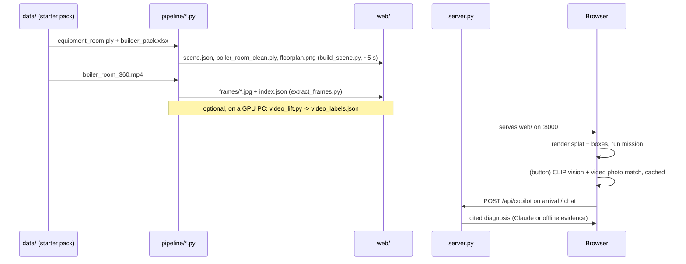

# Workflow, decisions and tools

## 1. End-to-end workflow

### Step by step
1. **Prepare the data.** Copy the three starter files into `data/` with the names given in the README. Nothing in `data/` is committed.
2. **Build the scene:** `python pipeline/build_scene.py data/equipment_room.ply data/builder_pack.xlsx web`.
   - Read the log: sanitize counts, floor and ceiling heights, grid size, number of walkable cells, objects, route length.
   - Check `web/floorplan.png`. Green is walkable, red is obstacle, blue are boxes, the red box is the target and yellow is the route.
3. **Extract the video frames:** `python pipeline/extract_frames.py data/boiler_room_360.mp4 web/frames 1`.
4. **Serve:** `python server.py`, then open http://localhost:8000. Wait for the splat to load (~395 MB, a few seconds).
5. **Run the vision pass once.** Press **AI labels (CLIP)**. The first run downloads the CLIP weights, indexes the video tiles (~2 min) and labels 414 boxes (~3 min). Later runs reuse the cache.
6. **Run the demo:** press **▶ Start mission** (see §3).
7. **Optional, on a GPU PC:**
   - set up a venv with CUDA torch and `requirements-gpu.txt`;
   - run `python pipeline/video_lift.py --selftest`;
   - run `python pipeline/video_lift.py data/boiler_room_360.mp4 web/scene.json data/equipment_room.ply work --fps 2`;
   - copy `web/video_labels.json` to the demo machine and reload the viewer.
8. **Optional:** `ANTHROPIC_API_KEY=… python server.py` turns on LLM answers to free-form questions.

### Re-running after changes
- Changing the splat, the Excel file or a pipeline parameter needs only step 2 again. Then do a hard reload in the browser.
- The vision cache is keyed by the object count and the target. When the scene changes, it is invalidated automatically.
- Tunable constants:
  - pipeline: top of `build_scene.py` (`VOXEL`, `COLOR_TOL`, `MIN_PTS`, `CELL`, `ROBOT_R`, `HEAD`);
  - viewer: `RADIUS`, `MAX_LABELS`, `MIN_SCORE`, `SIM_MIN` in `index.html`.

## 2. Verification we ran
- The pipeline asserts that the route exists and stays on walkable cells.
- `video_lift.py --selftest` checks the Umeyama similarity fit and the projection math.
- Copilot retrieval ran for all 30 assets plus an unknown ID (KeyError → 404).
- In the browser we checked the full mission (walk, arrive, diagnosis), the collision in Walk mode, the label cap, the vision pass, the CSLS match pairs (inspected visually) and that the cached results come back after a reload.
- **Not verified:**
  - the Claude path of the copilot (no API key was available);
  - `video_lift.py` end to end (it needs an x64 + CUDA machine);
  - non-Chromium browsers.

## 3. Demo script (≤ 5 min video)
1. **Overview (Orbit, All frames):** the full room with 414 boxes. Mention the colour-aware segmentation and NMS.
2. **Floor plan slide:** the grid, the obstacles and the A* route.
3. **▶ Start mission (Follow):** frames light up only within the radius, and the side panel lists nearby assets with their Excel status.
4. **Arrival at P-005:** the copilot report, with its 4 sections and evidence IDs. Ask a follow-up question.
5. **Click a nearby asset:** the 3D render next to the real video photo, plus the vision label.
6. **Walk mode:** walking into a wall stops you. That is the collision check against the nav grid.

## 4. Decisions log (what we found and changed)

| Problem | Evidence | Decision |
|---|---|---|
| The starter `.ply` was mostly garbage | 1.5 M vertices, but only the first 502,483 are valid. The tail has entropy 7.92 bits/byte, is not a compressed stream and is not copied from the videos. The zip CRC is OK, so it was broken at the source. | Detect and cut corrupted tails in the pipeline, then ask the mentors for an intact scan (`Equipment Room.ply`, 1,676,481 valid splats). |
| Naive `np.fromfile` after reading the header with `readline` gave NaNs | Buffered reads moved the file position | Read the whole file and use `np.frombuffer` from the end-of-header offset. |
| Few objects (19 → 46) | Plain voxel connectivity fused wall + pipe + pump | A colour-aware voxel graph gives 128 objects on the broken scan and 414 on the intact one. |
| The faulty pump landed on red plastic bins | The rule "red + low = pump" matched floor bins | Saturated red + wall-mounted + 0.2–0.8 m = pump; red on the floor = storage bin (not an asset); exact class is preferred for the target. |
| Labels overlapping on dense walls | 128+ boxes in view | Show labels only inside the radius and only on the 6 nearest, Excel assets first. |
| CLIP on splat renders was weak | Crops from 0.35 m were blur | Keep the camera ≥ 0.8 m away and add 80% context: confident labels went 41 → 65. |
| Loading CLIP stalled | fp32 weights are ~600 MB | q8 for the classifier and fp16 for the embeddings on WebGPU, which is ~4× faster than q8 there. |
| Photo matching dominated by one frame | A blank-wall frame was the top-1 match for 105/414 boxes | CSLS hubness correction plus a threshold calibrated on pairs: confident labels 56 → 73. |
| Clicking a 3D label showed no vision data | The click handler captured the raw scene object | The handler is bound to the live object. |
| `pandas` 3 rejected `agg("first")` | The server crashed during retrieval | Compute first/last/min/max/mean explicitly per series. |
| Pointer Lock refused in the embedded browser | `SecurityError` | WASD/arrow walking works without pointer lock; mouse-look is optional. |

## 5. Tools used

### To build the solution
| Tool | Use |
|---|---|
| **Claude Code** (Anthropic, Claude Opus 5.5) in the Claude desktop app | AI pair programmer: data forensics on the `.ply`, pipeline and viewer code, debugging, documentation |
| Claude desktop **built-in browser** | Running the viewer, checking the mission end to end, inspecting vision crops and match pairs, console/network debugging |
| Python 3.14 (ARM64) + NumPy, SciPy, pandas, openpyxl, Pillow | Pipeline, analysis scripts and floor-plan rendering |
| ffmpeg 9 | Frame extraction, video contact sheets |
| `unzip -t`, entropy/byte-structure scripts | Proving the starter `.ply` corruption |
| Git, GitHub | Version control (this repository) |

### Inside the solution
See [TECH_NOTE.md](../TECH_NOTE.md) for versions: three.js, Spark, transformers.js + CLIP, the Anthropic SDK, and the optional pycolmap, Open3D, PyTorch, CLIP-L and OWLv2.

## 6. Hardware notes
- **Dev laptop:** Windows 11 on ARM64. No PyTorch, OpenCV or pycolmap wheels exist for Python 3.14 arm64, so all ML runs in the browser on WebGPU there.
- **GPU PC:** i9-14th gen, RTX 4070 Laptop, 32 GB. This is the target for `video_lift.py`. Install the CUDA build of PyTorch from pytorch.org first. pycolmap from pip runs SIFT on the CPU, which takes minutes on an i9.
